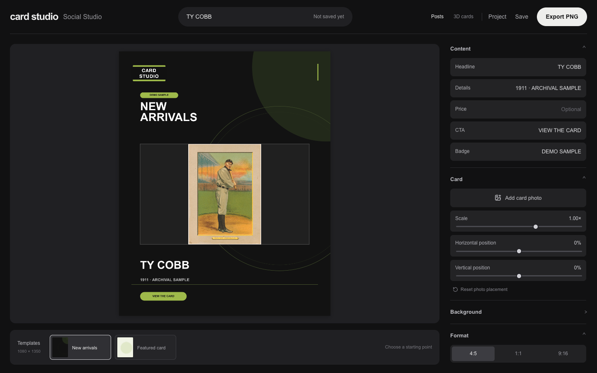
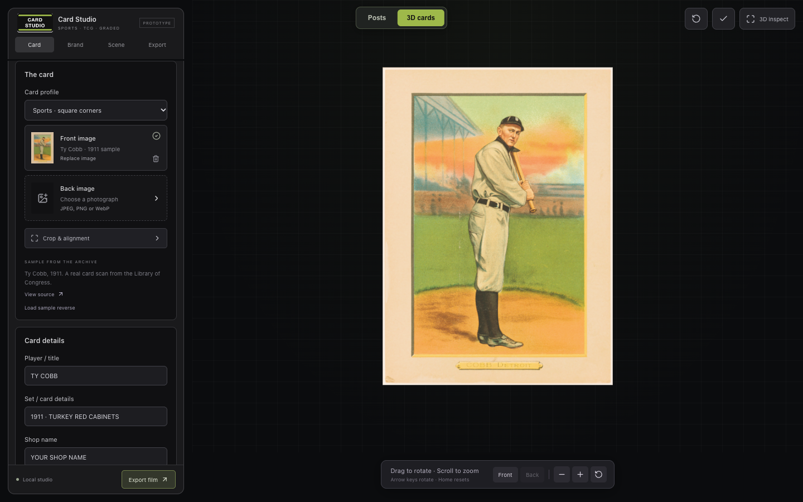

# Card Studio

A local tool for making social posts and short 3D videos of collectible cards (sports and trading cards). Drop in a photo of a card, pick a look, and export a ready-to-post image or a slow-turn video. Everything runs in your browser. No account, no server, no API keys.



## What it does

- **Posts:** build branded graphics in 4:5, 1:1 and 9:16 sizes. Edit the headline, details, price and badge, place the card photo, and export a PNG.
- **3D cards:** view a card photo as a live 3D object you can rotate and zoom. Supports square sports-card corners, rounded trading-card corners, and graded slabs.
- **Film export:** render a short MP4 of the card with studio lighting and a gentle sway or a full turn.



## Why I built it

Listing cards for sale means a lot of photos and a lot of social posts. I wanted one tool that turns a plain card photo into something worth posting, without paying for another subscription. I designed how it should look and work, directed AI tools to build it, and tested it against real card photos.

## Built with

React, TypeScript, Three.js (3D), Vite, Mediabunny (video export).

## Run it

Needs Node 22 and a current desktop Chrome or Edge for video export.

```bash
git clone https://github.com/gwbeats85/card-studio.git
cd card-studio
npm ci
npm run dev
```

Open http://127.0.0.1:5199/. Run `npm run preflight` to check types, tests and the production build.

## Privacy

Photos stay on your device. Nothing is uploaded.

## Credits

The sample card is a 1911 Ty Cobb scan from the Library of Congress. See [THIRD_PARTY_NOTICES.md](THIRD_PARTY_NOTICES.md).
